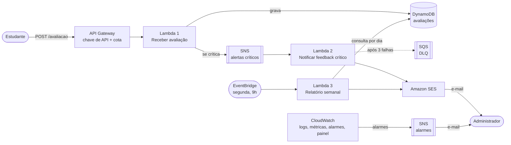

# Plataforma de Feedback — Tech Challenge Fase 4

Plataforma serverless na AWS em que estudantes avaliam aulas e administradores acompanham a satisfação: feedbacks críticos geram um aviso imediato por e-mail e, toda semana, um relatório consolidado é enviado.

Trabalho da Fase 4 da pós-graduação em Arquitetura e Desenvolvimento Java (FIAP Pós-Tech), com foco em Cloud Computing, Serverless e deploy em nuvem.

## Sumário

1. [Requisitos atendidos](#requisitos-atendidos)
2. [Arquitetura da solução](#arquitetura-da-solução)
3. [Modelo de cloud escolhido](#modelo-de-cloud-escolhido)
4. [Funções serverless](#funções-serverless)
5. [API](#api)
6. [Regras de negócio](#regras-de-negócio)
7. [Segurança e governança de acesso](#segurança-e-governança-de-acesso)
8. [Monitoramento](#monitoramento)
9. [Deploy](#deploy)
10. [Testando a aplicação](#testando-a-aplicação)
11. [Organização do código](#organização-do-código)
12. [Qualidade](#qualidade)
13. [Decisões e limitações](#decisões-e-limitações)

## Requisitos atendidos

| Requisito do enunciado | Como foi atendido |
|---|---|
| Ambiente de nuvem configurado, com segurança dos dados e governança de acesso | Toda a infraestrutura em [`template.yaml`](template.yaml): criptografia em repouso, um papel IAM de menor privilégio por função, API com chave e cota ([detalhes](#segurança-e-governança-de-acesso)) |
| Componentes de suporte (banco de dados etc.) | DynamoDB, SNS, SQS, SES e EventBridge declarados no mesmo template |
| Deploy automatizado dos componentes atualizáveis | Pipeline no GitHub Actions: testa, valida o template e publica com AWS SAM a cada push na `main` ([detalhes](#deploy)) |
| Aplicação monitorada | Logs estruturados, rastreamento com X-Ray, 6 alarmes com aviso por e-mail e um painel no CloudWatch ([detalhes](#monitoramento)) |
| Notificações automáticas aos administradores para problemas críticos | Feedback com nota de 0 a 3 dispara e-mail imediato; falhas da própria plataforma disparam alarmes por e-mail |
| Relatório semanal, com média de avaliações | Função agendada para toda segunda-feira, com média, quantidade por dia e por urgência |
| Serverless, com no mínimo duas funções e responsabilidade única | Três funções Lambda, cada uma com um único gatilho e um único motivo para mudar |

## Arquitetura da solução



Fluxo de um feedback:

1. O estudante envia `POST /avaliacao`. O API Gateway confere a chave de API e os limites de uso.
2. A **Lambda 1** valida os dados, classifica a urgência pela nota e grava a avaliação no DynamoDB.
3. Se a urgência for crítica, a Lambda 1 publica uma mensagem no tópico SNS e responde ao estudante sem esperar o e-mail.
4. A **Lambda 2** é acionada pelo tópico e envia o aviso ao administrador pelo SES. Se o envio falhar três vezes, a mensagem vai para a fila de mensagens não entregues (DLQ), que tem alarme.
5. Toda segunda-feira, o EventBridge aciona a **Lambda 3**, que lê as avaliações dos últimos sete dias, calcula o resumo e envia o relatório.

## Modelo de cloud escolhido

**FaaS (Function as a Service) em nuvem pública, na AWS.** O código roda em funções AWS Lambda e todo o restante são serviços gerenciados; não há servidor, contêiner ou cluster para administrar.

Por que esse modelo serve a este problema:

- **Carga irregular.** Feedbacks chegam em rajadas (fim de aula) e somem por horas. Funções escalam sozinhas e custam zero paradas, o que importa num ambiente de créditos limitados.
- **Fluxos orientados a eventos.** Os três fluxos do enunciado são reações a eventos (requisição HTTP, mensagem, agendamento), exatamente o que o Lambda integra de forma nativa.
- **Menos operação.** Disponibilidade, patches e escala ficam com o provedor (modelo de responsabilidade compartilhada). A equipe cuida do código, da configuração e das permissões.

Componentes e o papel de cada um:

| Componente | Papel | Por que este |
|---|---|---|
| API Gateway (REST) | Porta de entrada HTTP | Chave de API, cota e limite de requisições sem código |
| AWS Lambda (Java 21, arm64) | Execução das três funções | Paga por uso; arm64 é mais barato por milissegundo |
| DynamoDB (sob demanda) | Armazenamento das avaliações | Sem servidor, sem capacidade mínima, criptografado |
| SNS | Desacopla o recebimento do aviso por e-mail | O estudante não espera o e-mail; novas reações ao alerta entram como novos assinantes |
| SQS | Fila de mensagens não entregues (DLQ) | Nenhum alerta crítico é descartado em silêncio |
| SES | Envio de e-mails | Controle total do conteúdo e do formato da mensagem |
| EventBridge | Agendamento semanal | Cron gerenciado, sem servidor ligado esperando |
| CloudWatch e X-Ray | Logs, métricas, alarmes, painel e rastreamento | Nativos da plataforma |
| AWS SAM / CloudFormation | Infraestrutura como código | Todo o ambiente é reproduzível a partir de um arquivo |

As decisões principais, com as alternativas consideradas, estão registradas em [`docs/adr`](docs/adr).

## Funções serverless

### 1. Receber avaliação — `AvaliacaoFunction`

| | |
|---|---|
| Classe | [`AvaliacaoHandler`](src/main/java/adjt/fase4/feedback/handler/AvaliacaoHandler.java) |
| Gatilho | API Gateway, `POST /avaliacao` |
| Responsabilidade | Validar, classificar a urgência, gravar e publicar o alerta se a avaliação for crítica |
| Permissões | `dynamodb:PutItem` na tabela; `sns:Publish` no tópico de alertas |
| Variáveis | `TABELA_AVALIACOES`, `TOPICO_CRITICO_ARN` |

### 2. Notificar feedback crítico — `NotificacaoCriticaFunction`

| | |
|---|---|
| Classe | [`NotificacaoCriticaHandler`](src/main/java/adjt/fase4/feedback/handler/NotificacaoCriticaHandler.java) |
| Gatilho | Tópico SNS de alertas críticos |
| Responsabilidade | Enviar ao administrador o e-mail com descrição, urgência e data de envio |
| Permissões | `ses:SendEmail`, restrito ao remetente configurado; envio para a DLQ |
| Variáveis | `EMAIL_REMETENTE`, `EMAIL_ADMIN`, `FUSO_HORARIO` |
| Em caso de falha | O Lambda tenta mais duas vezes; depois a mensagem vai para a DLQ e o alarme dispara |

### 3. Relatório semanal — `RelatorioSemanalFunction`

| | |
|---|---|
| Classe | [`RelatorioSemanalHandler`](src/main/java/adjt/fase4/feedback/handler/RelatorioSemanalHandler.java) |
| Gatilho | EventBridge, `cron(0 12 ? * MON *)` (segunda-feira, 9h de Brasília) |
| Responsabilidade | Consultar os últimos sete dias, calcular o resumo e enviá-lo por e-mail |
| Permissões | `dynamodb:Query` apenas no índice `por-dia`; `ses:SendEmail`, restrito ao remetente |
| Variáveis | `TABELA_AVALIACOES`, `INDICE_POR_DIA`, `EMAIL_REMETENTE`, `EMAIL_ADMIN`, `FUSO_HORARIO` |

Conteúdo do relatório: período, total, **média das notas**, **quantidade por urgência**, **quantidade por dia** e a lista das avaliações com **descrição, urgência e data de envio**.

```text
RELATÓRIO SEMANAL DE FEEDBACKS
Período: 02/11/2026 a 09/11/2026 (America/Sao_Paulo)
Total de avaliações: 3
Média das notas: 5,33

QUANTIDADE POR URGÊNCIA
- CRITICA: 1
- ATENCAO: 1
- OK: 1

QUANTIDADE POR DIA
- 03/11/2026: 2
- 05/11/2026: 1

AVALIAÇÕES
- [OK] 03/11/2026 10:30:00 | nota 9 | Aula ótima
- [CRITICA] 03/11/2026 18:00:00 | nota 2 | Áudio ruim
- [ATENCAO] 05/11/2026 09:00:00 | nota 5 | Conteúdo mediano
```

## API

### `POST /avaliacao`

Cabeçalhos: `Content-Type: application/json` e `x-api-key: <chave>`.

```json
{
  "descricao": "O áudio da aula estava cortando",
  "nota": 2
}
```

| Campo | Tipo | Regra |
|---|---|---|
| `descricao` | texto | Obrigatório, não vazio, até 2000 caracteres |
| `nota` | inteiro | Obrigatório, de 0 a 10 |

Resposta `201 Created`:

```json
{
  "id": "0b1c6f0e-6d0e-4a5b-9d5e-2f2f3c1a7b11",
  "descricao": "O áudio da aula estava cortando",
  "nota": 2,
  "urgencia": "CRITICA",
  "dataEnvio": "2026-11-10T20:15:30.123Z"
}
```

| Status | Quando | Corpo |
|---|---|---|
| 201 | Avaliação registrada | A avaliação, com `id`, `urgencia` e `dataEnvio` |
| 400 | Corpo ausente, JSON malformado, tipo errado, campo desconhecido ou regra violada | `{"erro": "A nota deve estar entre 0 e 10"}` |
| 403 | Chave de API ausente ou inválida | Resposta do API Gateway |
| 429 | Limite de requisições ou cota diária excedidos | Resposta do API Gateway |
| 500 | Falha inesperada | `{"erro": "Erro interno ao registrar a avaliação"}` (o detalhe fica só no log) |

## Regras de negócio

| Nota | Urgência | Efeito |
|---|---|---|
| 0 a 3 | `CRITICA` | E-mail imediato ao administrador |
| 4 a 6 | `ATENCAO` | Aparece no relatório semanal |
| 7 a 10 | `OK` | Aparece no relatório semanal |

- A urgência é sempre derivada da nota ([`Urgencia`](src/main/java/adjt/fase4/feedback/domain/Urgencia.java)); o cliente não a informa.
- O intervalo da nota existe em um único lugar ([`Nota`](src/main/java/adjt/fase4/feedback/domain/Nota.java)) e as regras da avaliação valem também para dados lidos do banco ([`Avaliacao`](src/main/java/adjt/fase4/feedback/domain/Avaliacao.java)).
- Datas são gravadas em UTC e apresentadas, nos e-mails, no fuso do parâmetro `FusoHorario` (padrão `America/Sao_Paulo`). O agrupamento por dia do relatório usa esse mesmo fuso.

## Segurança e governança de acesso

**Dados**

- DynamoDB com criptografia em repouso (KMS) e recuperação a um ponto no tempo (PITR) de 35 dias.
- Tópico de alertas e fila DLQ criptografados; todo o tráfego entre serviços usa TLS.
- O feedback é anônimo: a API não recebe nem grava nome, e-mail ou identificador do estudante.
- Logs retidos por 14 dias. A aplicação registra apenas o identificador da avaliação, não a descrição.
- Mensagens de erro ao cliente não expõem detalhes internos.

**Acesso**

- Um papel IAM por função, somente com as ações e os recursos que ela usa. Exemplos: a função que recebe avaliações não lê a tabela; a do relatório só consulta o índice e não grava nada; nenhuma envia e-mail por outro remetente.
- API protegida por chave (`x-api-key`) associada a um plano de uso: 10 requisições por segundo, rajada de 20 e cota de 5000 por dia.
- Entrada validada na borda e de novo no domínio; tipos trocados e campos desconhecidos são recusados.
- Nenhum segredo no repositório. E-mails entram como parâmetros do deploy; no pipeline, vêm de *secrets* do GitHub.
- O pipeline assume um papel na AWS por OIDC, sem chave de acesso de longa duração.

## Monitoramento

| Recurso | O que oferece |
|---|---|
| Logs | Um grupo por função, em JSON (nível, identificador da requisição), retenção de 14 dias |
| Rastreamento | AWS X-Ray ativo no API Gateway e nas três funções |
| Painel | `FeedbackDashboard`: invocações, erros, tráfego e erros da API, duração (média e p99), alertas com problema e consumo do DynamoDB |
| Alarmes | Seis alarmes que publicam em um tópico SNS com o administrador inscrito por e-mail |

| Alarme | Dispara quando |
|---|---|
| `ApiErros5xxAlarm` | A API responde 5XX |
| `AvaliacaoErrosAlarm` | A função de avaliações falha ao iniciar ou estoura o tempo |
| `AlertaNaoPublicadoAlarm` | Um feedback crítico foi gravado, mas o alerta não chegou ao tópico |
| `NotificacaoErrosAlarm` | O envio do e-mail de alerta falha |
| `NotificacaoDLQAlarm` | Há alerta crítico parado na DLQ |
| `RelatorioErrosAlarm` | O relatório semanal falha |

O endereço do painel sai no *output* `DashboardUrl` da pilha.

## Deploy

### Pré-requisitos

- Conta AWS e [AWS SAM CLI](https://docs.aws.amazon.com/serverless-application-model/latest/developerguide/install-sam-cli.html) configurados.
- Java 21 e Maven 3.9+.
- No Amazon SES, na região do deploy, a identidade do e-mail remetente verificada. Com a conta no *sandbox* do SES, o e-mail do administrador também precisa estar verificado.

### Deploy manual

```bash
mvn clean verify
```

```bash
sam deploy --guided --stack-name feedback-platform --capabilities CAPABILITY_IAM --resolve-s3
```

O SAM pede os parâmetros `EmailRemetente`, `EmailAdmin` e `FusoHorario`. Ao final, o administrador recebe um e-mail do SNS para **confirmar a inscrição nos alarmes**.

### Deploy automatizado

O fluxo [`ci-cd.yml`](.github/workflows/ci-cd.yml) roda em todo push e pull request:

1. **Build e testes:** `mvn verify` (testes, regras de arquitetura e cobertura mínima) e `sam validate --lint`.
2. **Deploy** (somente na `main`): `sam deploy` com o pacote gerado na etapa anterior.

Preparação, feita uma única vez:

1. Criar na conta AWS o papel que o GitHub assume, a partir de [`infra/github-oidc.yaml`](infra/github-oidc.yaml):

```bash
aws cloudformation deploy --stack-name feedback-platform-github-oidc --template-file infra/github-oidc.yaml --capabilities CAPABILITY_NAMED_IAM
```

   O papel só pode ser assumido pela branch `main` e pelo ambiente `producao` deste repositório, e suas permissões se limitam aos serviços usados pela plataforma. Se a conta já tiver o provedor `token.actions.githubusercontent.com`, acrescente `--parameter-overrides CriarProvedorOidc=false`.

2. Cadastrar no repositório, em *Settings → Secrets and variables → Actions*:

| Tipo | Nome | Valor |
|---|---|---|
| Secret | `AWS_DEPLOY_ROLE_ARN` | ARN do papel criado no passo 1 (saída `PapelArn`) |
| Secret | `EMAIL_REMETENTE` | E-mail remetente verificado no SES |
| Secret | `EMAIL_ADMIN` | E-mail do administrador |
| Variable | `AWS_REGION` | Região do deploy (padrão `us-east-2`) |
| Variable | `STACK_NAME` | Nome da pilha (padrão `feedback-platform`) |

### Remover o ambiente

```bash
sam delete --stack-name feedback-platform
```

## Testando a aplicação

Obtenha o endereço e a chave nos *outputs* da pilha:

```bash
aws cloudformation describe-stacks --stack-name feedback-platform --query 'Stacks[0].Outputs' --output table
```

```bash
aws apigateway get-api-key --api-key <ApiKeyId> --include-value --query value --output text
```

Feedback crítico (gera e-mail imediato):

```bash
curl -i -X POST "<ApiUrl>" -H "Content-Type: application/json" -H "x-api-key: <chave>" -d '{"descricao":"O áudio da aula estava cortando","nota":2}'
```

Feedback positivo (entra só no relatório):

```bash
curl -i -X POST "<ApiUrl>" -H "Content-Type: application/json" -H "x-api-key: <chave>" -d '{"descricao":"Aula excelente","nota":10}'
```

Relatório semanal sem esperar a segunda-feira:

```bash
aws lambda invoke --function-name <RelatorioSemanalFunctionName> --payload '{}' --cli-binary-format raw-in-base64-out /dev/stdout
```

## Organização do código

Arquitetura hexagonal (portas e adaptadores). As dependências apontam para dentro: bordas → aplicação → domínio.

```text
src/main/java/adjt/fase4/feedback
├── domain            Regras de negócio, sem dependência de AWS ou framework
│   ├── Avaliacao, Nota, Urgencia
│   └── ResumoSemanal
├── application       Orquestração dos fluxos
│   ├── usecase       RegistrarAvaliacao, NotificarFeedbackCritico, GerarRelatorioSemanal
│   ├── port          Interfaces do que a aplicação precisa do mundo externo
│   └── dto           Contrato da mensagem de alerta crítico
├── infrastructure    Adaptadores de saída: DynamoDB, SNS, SES e configuração
└── handler           Adaptadores de entrada: as três funções Lambda
```

- O **domínio** só conhece Java. É onde ficam a classificação de urgência, as regras da avaliação e o cálculo do relatório.
- A **aplicação** descreve os casos de uso e depende de interfaces (portas), nunca de um serviço da AWS.
- A **infraestrutura** implementa as portas; trocar o SES por outro provedor não toca em regra de negócio.
- Os **handlers** traduzem o evento da AWS para o caso de uso e montam as dependências reais.

Essas regras são verificadas automaticamente por [`ArquiteturaTest`](src/test/java/adjt/fase4/feedback/arquitetura/ArquiteturaTest.java): o build falha se, por exemplo, o domínio importar algo da AWS.

## Qualidade

```bash
mvn clean verify
```

- 87 testes automatizados (JUnit 5), sem acesso à rede: domínio, casos de uso, handlers e adaptadores (com clientes AWS substituídos por dublês em memória).
- Testes de arquitetura com ArchUnit.
- Cobertura de linhas medida pelo JaCoCo, com mínimo de 80% exigido no build (relatório em `target/site/jacoco/index.html`).

## Decisões e limitações

As decisões estão em [`docs/adr`](docs/adr):

| ADR | Decisão |
|---|---|
| [0001](docs/adr/0001-serverless-na-aws.md) | Serverless com AWS Lambda e SAM |
| [0002](docs/adr/0002-arquitetura-hexagonal.md) | Arquitetura hexagonal dentro das funções |
| [0003](docs/adr/0003-dynamodb-com-indice-por-dia.md) | DynamoDB com índice por dia para o relatório |
| [0004](docs/adr/0004-alerta-critico-assincrono.md) | Alerta crítico assíncrono via SNS, com tratamento de falhas |
| [0005](docs/adr/0005-api-com-chave-e-plano-de-uso.md) | API protegida por chave e plano de uso |

Limitações conhecidas:

- **Chave de API não identifica o estudante.** Ela controla quem pode chamar a API e quanto; autenticação individual (por exemplo, Amazon Cognito) seria o passo seguinte.
- **Gravação e alerta não são atômicos.** Se o alerta não puder ser publicado, a avaliação fica salva e um alarme avisa o administrador; não há reenvio automático desse alerta (ver ADR 0004).
- **SES em *sandbox*.** Em conta nova, só é possível enviar para endereços verificados.
- **Relatório em texto puro**, enviado a um único destinatário.
